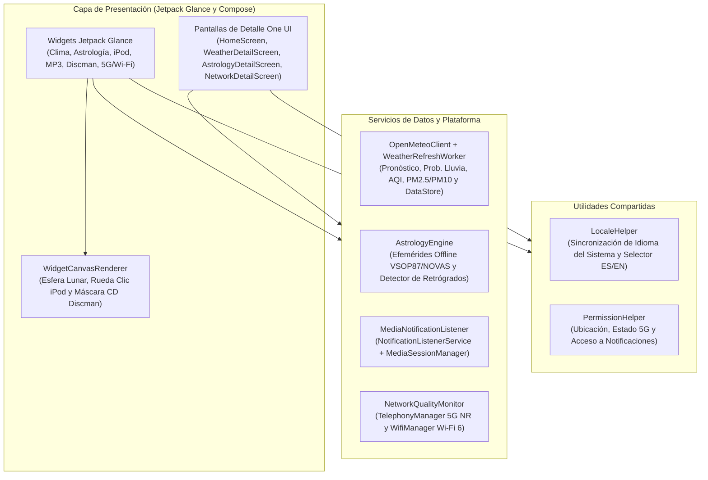

# One UI Extra Widgets

> **Suite de widgets de pantalla de inicio con diseño Samsung One UI para Android 8.0 a 15, creada con foco principal en el Samsung Galaxy A55 5G (`One UI 6.1 / 7+`) y compatibilidad multi-dispositivo.**

[English](README.md) | [Español](README.es.md)

[](https://developer.android.com/)
[](https://developer.samsung.com/one-ui)
[](https://kotlinlang.org/)
[](https://developer.android.com/jetpack/compose)
[](https://developer.android.com/develop/ui/compose/glance)
[](app/src/test)
[](LICENSE)

---

## Descripción del Proyecto

**One UI Extra Widgets** amplía la pantalla de inicio de teléfonos Samsung Galaxy con seis widgets eficientes en batería y diseñados bajo los lineamientos visuales de **Samsung One UI** (esquinas redondeadas de `26dp`, superficies translúcidas adaptativas día/noche y cabeceras ergonómicas pensadas para el uso con una sola mano). Aunque su foco principal es el **Samsung Galaxy A55 5G** (pantalla Super AMOLED `1080×2340`), utiliza APIs estándar de Android Jetpack (`minSdk = 26`, `targetSdk = 35`) para garantizar compatibilidad total con cualquier teléfono Android moderno sin requerir root ni permisos de firma del sistema.

### Características Principales

- **Widget Clima Pro One UI (`OneUiWeatherWidget`)**: Consulta probabilidad de lluvia por hora (`%`), Índice de Calidad del Aire (`AQI`), material particulado $\text{PM}_{2.5}$ / $\text{PM}_{10}$, índice UV y temperatura mediante las APIs abiertas y sin clave de **Open-Meteo**. Incluye una esfera de fase lunar renderizada en `Canvas` y abre la pantalla de detalle de Clima de la app al tocarlo.
- **Widget de Astrología y Efemérides 100% Offline (`OneUiAstrologyWidget`)**: Impulsado localmente por `Astronomy Engine` (`io.github.cosinekitty:astronomy`) sin consumo de datos móviles. Calcula longitudes eclípticas geocéntricas aparentes ($\lambda$) y velocidades angulares diarias ($d\lambda/dt$) para mostrar el **Signo Solar actual**, el **Tránsito Lunar del día** (en qué signo está la Luna hoy), el porcentaje de iluminación lunar y si **Mercurio, Venus, Marte, Júpiter o Saturno** están **Directos**, **Retrógrados** ($d\lambda/dt < 0$) o en **Sombra Pre/Post-Retrógrada**.
- **Widgets de Música Retro — iPod Classic, MP3 LCD 2000s y Discman CD Portátil**:
  1. *iPod Classic (`IpodClassicWidget`)*: Incorpora una rueda clic (*Click Wheel*) renderizada en `Canvas` con zonas interactivas para pista anterior, reproducir/pausar y pista siguiente.
  2. *Reproductor MP3 LCD Años 2000 (`RetroMp3Widget`)*: Formato compacto horizontal (`4×1`) con estética de pantalla LCD de matriz de puntos retroiluminada e indicador `128KBPS STEREO`.
  3. *Discman CD Portátil (`DiscmanWidget`)*: Ventana circular que recorta dinámicamente la carátula de la canción actual en forma de disco compacto (CD) con aro central reflectante y controles *ESP Anti-Shock*.
  - Los tres widgets se sincronizan automáticamente con **Spotify, YouTube Music, Apple Music, Samsung Music, Tidal** o cualquier reproductor activo en Android mediante `NotificationListenerService` y `MediaSessionManager`.
- **Widget de Calidad de Red 5G NR y Wi-Fi 6 (`OneUiNetworkWidget`)**: Inspecciona `TelephonyManager`, `CellSignalStrengthNr`, `ConnectivityManager` y `WifiInfo` para mostrar en tiempo real la generación móvil activa (`5G NR` / `4G LTE`), operador, potencia RSRP en `dBm` y barras (`0–4`), junto con la velocidad de enlace Wi-Fi en `Mbps`, banda de frecuencia (`5 GHz` / `2.4 GHz`), `RSSI` en `dBm` y nombre de red (`SSID`).
- **Localización Bilingüe Automática y Manual (ES / EN)**: Detecta por defecto el idioma configurado en el teléfono (Español) e incluye un selector instantáneo dentro de la app (**Automático / Español / English**) basado en `AppCompatDelegate.setApplicationLocales` y `LocaleConfig` de Android 14+.

---

## Arquitectura Limpia

One UI Extra Widgets mantiene un desacoplamiento claro entre las superficies de widgets en Jetpack Glance, las pantallas de detalle en Jetpack Compose, los servicios de datos/plataforma y las utilidades compartidas de renderizado y localización.



### Responsabilidades por Componente

| Componente / Paquete | Responsabilidad |
| :--- | :--- |
| **`widgets/`** | Implementaciones 100% en Jetpack Glance (`OneUiWeatherWidget`, `WeatherRefreshWorker`, `OneUiAstrologyWidget`, `IpodClassicWidget`, `RetroMp3Widget`, `DiscmanWidget`, `OneUiNetworkWidget`) y tokens de diseño `OneUiGlanceTokens` (radio `26dp`, superficies día/noche). |
| **`ui/`** | Aplicación compañera en Jetpack Compose Material 3 con estética Samsung One UI, galería de widgets, configuración de permisos, selector de idioma y pantallas de detalle. |
| **`data/astrology/`** | Motor determinista `AstrologyEngine` para el cálculo offline de signos zodiacales tropicales, ángulo de fase lunar y estados retrógrados o de sombra planetaria. |
| **`data/weather/`** | Cliente HTTP `OpenMeteoClient` para obtener pronóstico en tiempo real, probabilidad de lluvia, índice UV y calidad del aire (AQI europeo). |
| **`data/preferences/`** | Caché persistente en `DataStore` (`AppPreferences`) para almacenar clima, ubicación y estado de configuración de widgets. |
| **`data/media/`** | Servicio `MediaNotificationListener` que escucha sesiones `MediaController` activas y envía comandos de transporte (`play`, `pause`, `skipToNext`, `skipToPrevious`). |
| **`data/network/`** | Monitor `NetworkQualityMonitor` para extraer métricas `dBm` de redes 5G NR / LTE y velocidad `Mbps`, banda y `RSSI` en redes Wi-Fi 6. |
| **`utils/`** | Utilidades centralizadas `WidgetCanvasRenderer`, `LocaleHelper` y `PermissionHelper` reutilizadas entre widgets y actividades sin duplicación de lógica. |

Para consultar la investigación técnica detallada y las especificaciones de APIs, revisa:
- [docs/external-references/android-oneui-widgets-architecture.md](docs/external-references/android-oneui-widgets-architecture.md)

---

## Stack Tecnológico

- **Lenguaje y Entorno de Ejecución**: Kotlin 2.0.21, JVM Target 17
- **Sistema de Compilación**: Android Gradle Plugin 8.7.2, Catálogo de Versiones (`gradle/libs.versions.toml`)
- **Compatibilidad Android**: `minSdk = 26` (Android 8.0 Oreo), `targetSdk = 35` / `compileSdk = 35` (Android 15 / One UI 6.1 y 7+)
- **Framework de Widgets**: Jetpack Glance (`androidx.glance:glance-appwidget:1.1.1`, `glance-material3:1.1.1`) + gráficos personalizados en Android `Canvas`
- **Interfaz de Usuario**: Jetpack Compose BOM 2024.11.00, Material 3, AppCompat 1.7.0 (soporte de idiomas por app)
- **Efemérides Astronómicas Offline**: `io.github.cosinekitty:astronomy:2.1.19`
- **Sincronización y Persistencia**: `WorkManager` 2.10.0, `DataStore Preferences` 1.1.1
- **Pruebas Automatizadas**: JUnit 4 para pruebas unitarias en la JVM

---

## Compilación y Ejecución

### Requisitos Previos

- [JDK 17+](https://adoptium.net/) (o el JBR incluido en Android Studio)
- [Android SDK (API 35)](https://developer.android.com/studio)

### Configuración Local y Compilación

Clona el repositorio y compila el proyecto:

```bash
# Clonar el repositorio
git clone https://github.com/AnaCataVC/one-ui-extra-widgets.git
cd one-ui-extra-widgets

# Ejecutar las pruebas unitarias en la JVM
./gradlew testDebugUnitTest

# Compilar el APK de depuración
./gradlew assembleDebug
```

El binario resultante se generará en:
`app/build/outputs/apk/debug/app-debug.apk`

---

## Pruebas Automatizadas

`one-ui-extra-widgets` incluye pruebas unitarias que validan el mapeo de límites de signos zodiacales tropicales, los rangos de iluminación lunar y el cálculo offline de estados retrógrados planetarios:

```bash
./gradlew testDebugUnitTest
```

---

## Decisiones de Arquitectura y Aprendizajes

1. **¿Por qué Open-Meteo en lugar del ContentProvider interno de Samsung Weather?**
   - El servicio preinstalado de clima de Samsung (`com.sec.android.daemonapp`) utiliza una clave corporativa cerrada de *The Weather Channel* y protege su `ContentProvider` interno con permisos `signatureOrSystem` en versiones modernas de One UI. Combinar los endpoints de pronóstico y calidad del aire de Open-Meteo entrega probabilidad de lluvia por hora, índice UV y calidad del aire europea (`AQI`, $\text{PM}_{2.5}$ y $\text{PM}_{10}$) de forma gratuita y sin claves API, abriendo nuestra propia pantalla de detalle estilo One UI al tocar el widget.
2. **¿Por qué un motor de efemérides 100% offline para Astrología y Fases de la Luna?**
   - Las posiciones planetarias, el tránsito del Sol y la Luna por los signos del zodíaco y los ciclos de retrogradación aparente son funciones astronómicas deterministas del tiempo. Calcular las longitudes eclípticas geocéntricas ($\lambda$) y su derivada diaria ($d\lambda/dt < 0$) localmente con `Astronomy Engine` elimina la latencia de red, funciona sin conexión a internet y reduce a cero el consumo extra de batería.
3. **100% Jetpack Glance combinado con gráficos Canvas personalizados:**
   - Jetpack Glance permite declarar la jerarquía de widgets con sintaxis estilo Compose, mientras que los elementos gráficos complejos —como el terminador de iluminación de la Luna, la rueda clic del iPod Classic y el recorte circular de carátula tipo CD para el Discman— se dibujan de forma determinista en `WidgetCanvasRenderer` y se entregan como `Bitmap` a `ImageProvider`.
4. **Control Universal de Reproducción sin SDKs Propietarios:**
   - En lugar de acoplar la app al SDK de un servicio específico, `NotificationListenerService` junto con `MediaSessionManager` lee los metadatos y la carátula del reproductor que esté activo en el dispositivo (Spotify, YouTube Music, Apple Music, Samsung Music, etc.) y envía comandos nativos `MediaController.TransportControls` directamente desde los botones táctiles de cada widget retro.

---

## Licencia

Este proyecto está bajo la Licencia MIT. Consulta el archivo [LICENSE](LICENSE) para más detalles.
