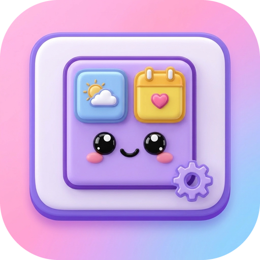
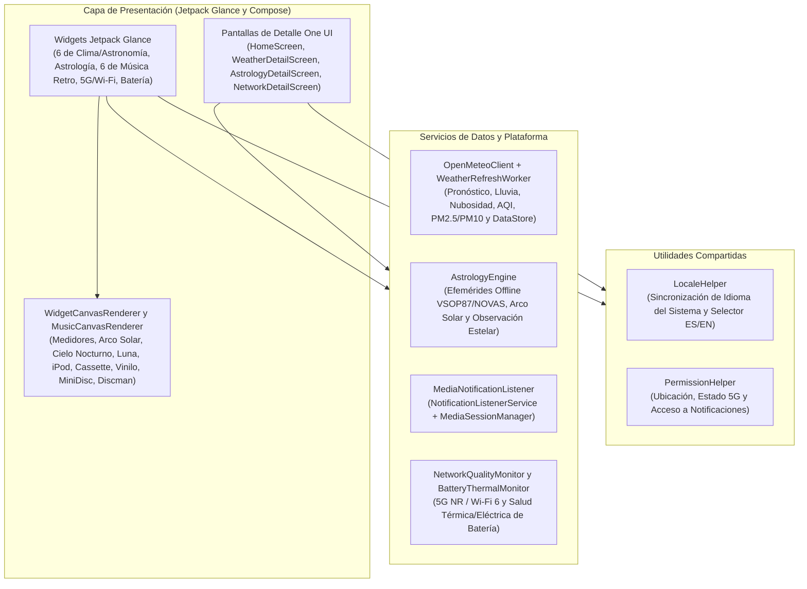

<p align="center">
  
</p>

# One UI Extra Widgets

> **Suite de widgets de pantalla de inicio con diseño Samsung One UI para Android 8.0 a 16, creada con foco principal en el Samsung Galaxy A55 5G (`One UI 8.5`) y compatibilidad multi-dispositivo.**

[English](README.md) | [Español](README.es.md)

[](https://developer.android.com/)
[](https://developer.samsung.com/one-ui)
[](https://kotlinlang.org/)
[](https://developer.android.com/jetpack/compose)
[](https://developer.android.com/develop/ui/compose/glance)
[](app/src/test)
[](LICENSE)

---

## Descripción del Proyecto

**One UI Extra Widgets** amplía la pantalla de inicio de teléfonos Samsung Galaxy con quince widgets eficientes en batería y diseñados bajo los lineamientos visuales de **Samsung One UI** (esquinas redondeadas de `26dp`, superficies translúcidas adaptativas día/noche y cabeceras ergonómicas pensadas para el uso con una sola mano). Aunque su foco principal es el **Samsung Galaxy A55 5G** (pantalla Super AMOLED `1080×2340`, **One UI 8.5 / Android 16**), utiliza APIs estándar de Android Jetpack (`minSdk = 26`, `targetSdk = 36`) para garantizar compatibilidad total con cualquier teléfono Android moderno sin requerir root ni permisos de firma del sistema.

### Características Principales

- **6 Widgets Modulares de Clima, Sol y Astronomía Científica One UI** ([especificaciones](docs/weather-widgets.md)):
  - Diseñados como píldoras compactas (`SizeMode.Exact`) redimensionables en formatos `1×1`, `2×1`, `2×2` y `4×2` **sin repetir la temperatura actual** (ya cubierta por el widget nativo de Samsung):
  1. *Probabilidad de Lluvia (`OneUiRainWidget`)*: Arco de progreso radial en `Canvas` con gota central esculpida que muestra la probabilidad máxima de precipitación en 6 horas (`%`) y su nivel de intensidad vía **Open-Meteo**.
  2. *Calidad del Aire (`OneUiAqiWidget`)*: Medidor radial de `270°` con código de color europeo (`AQI`) y desglose de material particulado $\text{PM}_{2.5}$ y $\text{PM}_{10}$ ($\mu\text{g/m}^3$).
  3. *Índice UV Solar (`OneUiUvWidget`)*: Medidor solar en arco de `270°` en escala OMS (`0–11+`) con nivel de riesgo y guía de protección FPS.
  4. *Fase Lunar Científica (`OneUiMoonPhaseWidget`)*: Esfera lunar `Canvas` de alto contraste con datos astronómicos 100% científicos (porcentaje de iluminación `%`, edad sinódica `0.0–29.5 d`, ángulo de elongación solar y ciclo creciente/menguante, sin signos astrológicos).
  5. *Arco Solar y Hora Dorada (`OneUiSunArcWidget`)*: Arco de elevación solar 100% offline en `Canvas` calculado con `Astronomy Engine`, mostrando la fase lumínica actual (**Día Solar / Hora Dorada / Hora Azul / Crepúsculo / Noche**), próxima transición de Hora Dorada, duración del día y horarios de amanecer/atardecer.
  6. *Cielo Nocturno y Observación Estelar (`OneUiStargazingWidget`)*: Cruza la nubosidad (`cloud_cover`) de Open-Meteo con la oscuridad lunar offline para puntuar la claridad del cielo nocturno (`0–100%`) e indicar qué planetas son visibles a simple vista sobre el horizonte local.
- **Widget 100% Offline de Astrología: Tránsitos y Retrógrados (`OneUiAstrologyWidget`)** ([especificaciones](docs/astrology-widget.md) · [motor de efemérides](docs/astrology-engine.md)): Impulsado localmente por `Astronomy Engine` (`io.github.cosinekitty:astronomy`) sin consumo de datos móviles. Calcula longitudes eclípticas geocéntricas aparentes ($\lambda$) y velocidades angulares diarias ($d\lambda/dt$) para mostrar un emblema orbital `Canvas` de Mercurio, el **Signo Solar actual**, el **Tránsito Lunar del día** (signo zodiacal) y una barra de 5 planetas indicando si **Mercurio, Venus, Marte, Júpiter o Saturno** están **Directos**, **Retrógrados** ($d\lambda/dt < 0$) o en **Sombra Pre/Post-Retrógrada** (sin duplicar la fase lunar, exclusiva de `OneUiMoonPhaseWidget`).
- **6 Reproductores de Música Retro — iPod Classic, MP3 USB 2000s, Discman CD, Walkman Cassette, Tocadiscos Vinilo y MiniDisc** ([especificaciones](docs/retro-music-widgets.md)):
  1. *iPod Classic (`IpodClassicWidget`)*: Diseño responsivo (`SizeMode.Exact`) con carátula de álbum, barra de progreso One UI con marcas de tiempo (`0:00`), rueda clic `Canvas` de 5 zonas táctiles con botón central dinámico y lectura del modelo del teléfono.
  2. *Reproductor MP3 USB 2000s (`RetroMp3Widget`)*: Pendrive One UI azul índigo-cobalto `4×1` con tapa USB lateral y ranura para correa, controles circulares ergonómicos, pantalla oscura de alto contraste con detalles dorados, jerarquía cyan/pizarra, ecualizador de 5 barras y barra inferior que se apila al estirarse verticalmente.
  3. *Discman CD Circular (`DiscmanWidget`)*: Cuerpo circular 1:1 en grafito mate con bisel metálico, detalle superior de pestillo, rejilla de altavoz, pantalla LCD **cyan** (pista + tiempo `00:00` + indicador de batería sin carátula) y fila ergonómica de 4 botones.
  4. *Walkman Cassette 80s/90s (`CassetteWalkmanWidget`)*: Carcasa metálica Walkman con ventana acrílica en `Canvas`, carretes de 6 dientes en rotación continua cuyos radios de cinta cambian dinámicamente según el progreso (`0%–100%`), rodillos guía, vúmetro LED de picos, etiqueta Type II CrO2, contador de 3 dígitos y 4 botones físicos biselados.
  5. *Tocadiscos Vinilo Minimalista (`VinylTurntableWidget`)*: Plato inspirado en Braun/Dieter Rams con selector rotativo, control deslizante de pitch, borde estroboscópico con prisma luminoso, disco LP micro-surcado con brillo anisotrópico dinámico, carátula circular giratoria en el sello central, brazo fonocaptor articulado y barras de espectro Hi-Fi.
  6. *MiniDisc Hi-MD 2000s (`MiniDiscWidget`)*: Reproductor metálico azul pizarra (`4×1` / `STACKED`) con ventana iridiscente de cartucho MiniDisc en `Canvas`, pantalla electroluminiscente `HI-MD • ATRAC DSP`, analizador de espectro y botones plateados ergonómicos.
  - Los seis widgets incluyen vistas previas XML (`previewLayout`) en el selector de One UI y se sincronizan con **Spotify, YouTube Music, Apple Music, Samsung Music, Tidal** o cualquier `MediaSession` activa (con fallback mediante teclas multimedia de `AudioManager`).
- **Diagnóstico de Red 5G NR / Wi-Fi 6 y Salud Térmica de Batería (`OneUiNetworkWidget` y `OneUiBatteryThermalWidget`)** ([especificaciones](docs/network-widget.md)):
  1. *Calidad de Red 5G NR y Wi-Fi 6 (`OneUiNetworkWidget`)*: Formato `2×2` por defecto (`SizeMode.Exact`) adaptable a píldoras `2×1`/`4×1` y tableros `4×2`, con insignias en `Canvas` para `5G NR` / `4G LTE` (`dBm`, operador) y Wi-Fi (`Mbps`, banda, `RSSI`, `SSID`).
  2. *Salud Térmica y Eléctrica de Batería (`OneUiBatteryThermalWidget`)*: Monitor 100% offline vía `BatteryManager` sin permisos adicionales, con medidor radial de `270°` por rango térmico (`°C`), voltaje (`mV`), corriente (`mA`), potencia (`W`) y fuente de energía (`USB PD / AC / USB / Inalámbrica`).
- **Localización Bilingüe Automática y Manual (ES / EN)**: Detecta por defecto el idioma configurado en el teléfono (Español) e incluye un selector instantáneo dentro de la app (**Automático / Español / English**) basado en `AppCompatDelegate.setApplicationLocales` y `LocaleConfig` de Android 14+.

---

## Arquitectura Limpia

One UI Extra Widgets mantiene un desacoplamiento claro entre las superficies de widgets en Jetpack Glance, las pantallas de detalle en Jetpack Compose, los servicios de datos/plataforma y las utilidades compartidas de renderizado y localización.



### Responsabilidades por Componente

| Componente / Paquete | Responsabilidad |
| :--- | :--- |
| **`widgets/`** | Implementaciones 100% en Jetpack Glance (`OneUiRainWidget`, `OneUiAqiWidget`, `OneUiUvWidget`, `OneUiMoonPhaseWidget`, `OneUiSunArcWidget`, `OneUiStargazingWidget`, `WeatherRefreshWorker`, `OneUiAstrologyWidget`, `IpodClassicWidget`, `RetroMp3Widget`, `DiscmanWidget`, `CassetteWalkmanWidget`, `VinylTurntableWidget`, `MiniDiscWidget`, `OneUiNetworkWidget`, `OneUiBatteryThermalWidget`) y tokens de diseño `OneUiGlanceTokens` (radio `26dp`, superficies día/noche). |
| **`ui/`** | Aplicación compañera en Jetpack Compose Material 3 con estética Samsung One UI, galería de widgets, configuración de permisos, selector de idioma y pantallas de detalle. |
| **`data/astrology/`** | Motor determinista `AstrologyEngine` para el cálculo offline de signos zodiacales tropicales, ángulo de fase lunar, estados retrógrados/sombra, arco solar / Hora Dorada y claridad nocturna. |
| **`data/weather/`** | Cliente HTTP `OpenMeteoClient` para obtener pronóstico en tiempo real, probabilidad de lluvia, nubosidad, índice UV y calidad del aire (AQI europeo). |
| **`data/preferences/`** | Caché persistente en `DataStore` (`AppPreferences`) para almacenar clima, ubicación y estado de configuración de widgets. |
| **`data/media/`** | Servicio `MediaNotificationListener` que escucha sesiones `MediaController` activas y envía comandos de transporte (`play`, `pause`, `skipToNext`, `skipToPrevious`). |
| **`data/network/`** | Monitor `NetworkQualityMonitor` para extraer métricas `dBm` de redes 5G NR / LTE y velocidad `Mbps`, banda y `RSSI` en redes Wi-Fi 6. |
| **`data/battery/`** | Monitor `BatteryThermalMonitor` para leer temperatura (`°C`), voltaje (`mV`), corriente (`mA`), potencia (`W`) y fuente de carga sin permisos adicionales. |
| **`utils/`** | Utilidades centralizadas `WidgetCanvasRenderer`, `MusicCanvasRenderer`, `AstrologyCanvasRenderer`, `LocaleHelper` y `PermissionHelper` reutilizadas entre widgets y actividades sin duplicación de lógica. |

Para consultar la investigación técnica detallada, optimizaciones de rendimiento/batería y especificaciones de APIs, revisa:
- [docs/performance-and-battery.md](docs/performance-and-battery.md)
- [docs/external-references/android-oneui-widgets-architecture.md](docs/external-references/android-oneui-widgets-architecture.md)

---

## Stack Tecnológico

- **Lenguaje y Entorno de Ejecución**: Kotlin 2.0.21, JVM Target 17
- **Sistema de Compilación**: Android Gradle Plugin 8.7.2, Catálogo de Versiones (`gradle/libs.versions.toml`)
- **Compatibilidad Android**: `minSdk = 26` (Android 8.0 Oreo), `targetSdk = 36` / `compileSdk = 36` (Android 16 / One UI 8.5, compatible con One UI 6.1–8.0)
- **Framework de Widgets**: Jetpack Glance (`androidx.glance:glance-appwidget:1.1.1`) + gráficos personalizados en Android `Canvas`
- **Interfaz de Usuario**: Jetpack Compose BOM 2024.11.00, Material 3, AppCompat 1.7.0 (soporte de idiomas por app)
- **Efemérides Astronómicas Offline**: `io.github.cosinekitty:astronomy:2.1.19`
- **Sincronización y Persistencia**: `WorkManager` 2.10.0, `DataStore Preferences` 1.1.1
- **Pruebas Automatizadas**: JUnit 4 para pruebas unitarias en la JVM

---

## Compilación y Ejecución

### Requisitos Previos

- [JDK 17+](https://adoptium.net/) (o el JBR incluido en Android Studio)
- [Android SDK (API 36)](https://developer.android.com/studio)

### Configuración Local y Compilación

Clona el repositorio y compila el proyecto:

```bash
# Clonar el repositorio
git clone https://github.com/AnaCataVC/one-ui-extra-widgets.git
cd one-ui-extra-widgets

# Ejecutar las pruebas unitarias en la JVM
./gradlew testDebugUnitTest

# Compilar el APK de depuración
./gradlew assembleDebug
```

El binario resultante se generará en:
`app/build/outputs/apk/debug/app-debug.apk`

---

## Pruebas Automatizadas

`one-ui-extra-widgets` incluye pruebas unitarias que validan el mapeo de límites de signos zodiacales tropicales, los rangos de iluminación lunar, el cálculo offline de estados retrógrados planetarios, elevación solar e índice de cielo nocturno, umbrales térmicos de batería, calculadores de diseño y compatibilidad `@RemoteView` de previews:

```bash
./gradlew testDebugUnitTest
```

---

## Decisiones de Arquitectura y Aprendizajes

1. **¿Por qué Open-Meteo en lugar del ContentProvider interno de Samsung Weather?**
   - El servicio preinstalado de clima de Samsung (`com.sec.android.daemonapp`) utiliza una clave corporativa cerrada de *The Weather Channel* y protege su `ContentProvider` interno con permisos `signatureOrSystem` en versiones modernas de One UI. Combinar los endpoints de pronóstico y calidad del aire de Open-Meteo entrega probabilidad de lluvia por hora, índice UV y calidad del aire europea (`AQI`, $\text{PM}_{2.5}$ y $\text{PM}_{10}$) de forma gratuita y sin claves API, abriendo nuestra propia pantalla de detalle estilo One UI al tocar el widget.
2. **¿Por qué un motor de efemérides 100% offline para Astrología y Fases de la Luna?**
   - Las posiciones planetarias, el tránsito del Sol y la Luna por los signos del zodíaco y los ciclos de retrogradación aparente son funciones astronómicas deterministas del tiempo. Calcular las longitudes eclípticas geocéntricas ($\lambda$) y su derivada diaria ($d\lambda/dt < 0$) localmente con `Astronomy Engine` elimina la latencia de red, funciona sin conexión a internet y reduce a cero el consumo extra de batería.
3. **100% Jetpack Glance combinado con gráficos Canvas personalizados:**
   - Jetpack Glance permite declarar la jerarquía de widgets con sintaxis estilo Compose, mientras que los elementos gráficos complejos —como el terminador de iluminación de la Luna, la rueda clic del iPod Classic y el recorte circular de carátula tipo CD para el Discman— se dibujan de forma determinista en `WidgetCanvasRenderer` y se entregan como `Bitmap` a `ImageProvider`.
4. **Control Universal de Reproducción sin SDKs Propietarios:**
   - En lugar de acoplar la app al SDK de un servicio específico, `NotificationListenerService` junto con `MediaSessionManager` lee los metadatos y la carátula del reproductor que esté activo en el dispositivo (Spotify, YouTube Music, Apple Music, Samsung Music, etc.) y envía comandos nativos `MediaController.TransportControls` directamente desde los botones táctiles de cada widget retro.

---

## Licencia

Este proyecto está bajo la Licencia MIT. Consulta el archivo [LICENSE](LICENSE) para más detalles.
