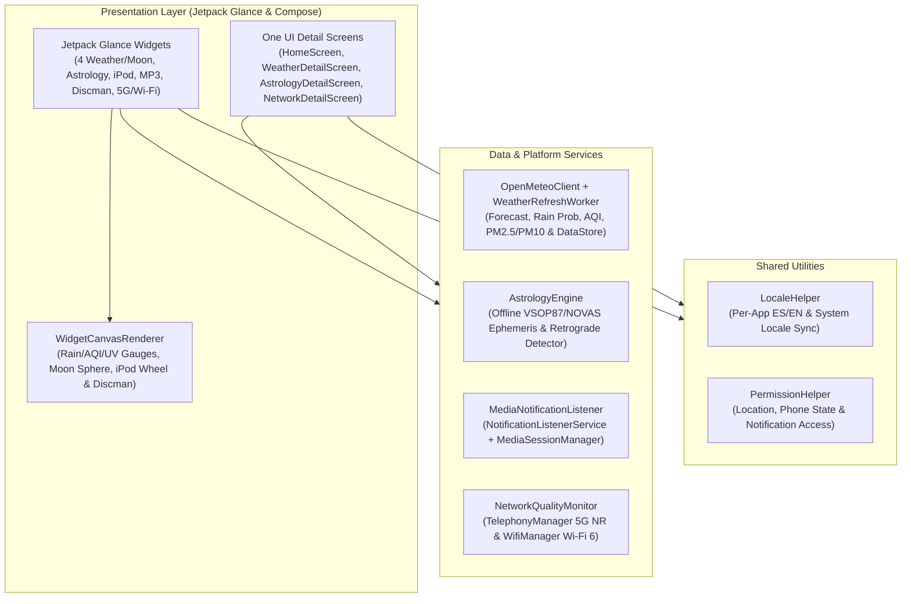

<p align="center">
  
</p>

# One UI Extra Widgets

> **Samsung One UI-styled home screen widget suite for Android 8.0 to 16, engineered primarily for the Samsung Galaxy A55 5G (`One UI 8.5`) with full cross-device compatibility.**

[English](README.md) | [Español](README.es.md)

[](https://developer.android.com/)
[](https://developer.samsung.com/one-ui)
[](https://kotlinlang.org/)
[](https://developer.android.com/jetpack/compose)
[](https://developer.android.com/develop/ui/compose/glance)
[](app/src/test)
[](LICENSE)

---

## Project Description

**One UI Extra Widgets** expands the Samsung Galaxy home screen experience with nine customizable, battery-efficient widgets crafted around **Samsung One UI** design tokens (`26dp` squircle-like corner radii, adaptive day/night translucent surfaces, and ergonomic one-handed viewing headers). While tuned specifically for the **Samsung Galaxy A55 5G** (`1080×2340` Super AMOLED, **One UI 8.5 / Android 16**), the suite relies on standard Android Jetpack APIs (`minSdk = 26`, `targetSdk = 36`) so it runs seamlessly on any modern Android device without root or system privileges.

### Key Features

- **4 Modular One UI Weather & Scientific Lunar Widgets** ([full specs](docs/weather-widgets.md)):
  - Designed as compact `2×1` pills (`SizeMode.Exact`) that resize smoothly into `2×2` squares or `4×2` wide cards **without repeating ambient temperature** (already provided by Samsung's stock Weather widget):
  1. *Rain Probability (`OneUiRainWidget`)*: `Canvas` radial progress arc with a sculpted droplet showing 6-hour precipitation probability (`%`) and intensity tier via **Open-Meteo**.
  2. *Air Quality (`OneUiAqiWidget`)*: `270°` color-coded European `AQI` radial gauge with $\text{PM}_{2.5}$ and $\text{PM}_{10}$ ($\mu\text{g/m}^3$) breakdown.
  3. *Solar UV Index (`OneUiUvWidget`)*: `270°` solar radiation gauge mapped to the WHO `0–11+` scale with risk tier and SPF protection guidance.
  4. *Scientific Lunar Phase (`OneUiMoonPhaseWidget`)*: High-contrast `Canvas` lunar sphere with 100% scientific astronomical metrics (illumination `%`, synodic age `0.0–29.5 d`, solar elongation angle, and waxing/waning trend—zero astrological signs).
- **100% Offline Astrology: Transits & Retrogrades Widget (`OneUiAstrologyWidget`)** ([full specs](docs/astrology-widget.md)): Powered locally by `Astronomy Engine` (`io.github.cosinekitty:astronomy`) with zero network calls. Computes apparent geocentric ecliptic longitudes ($\lambda$) and daily angular velocities ($d\lambda/dt$) to display a `Canvas` orbital Mercury emblem, the current **Sun Sign**, daily **Moon Zodiac Transit**, and a 5-planet strip showing whether **Mercury, Venus, Mars, Jupiter, or Saturn** are **Direct**, **Retrograde** ($d\lambda/dt < 0$), or in **Pre/Post-Retrograde Shadow** (without duplicating lunar phase illumination, which lives in `OneUiMoonPhaseWidget`).
- **Retro Music Players — iPod Classic, 2000s USB MP3 & Circular CD Discman** ([full specs](docs/retro-music-widgets.md)):
  1. *iPod Classic (`IpodClassicWidget`)*: Responsive `SizeMode.Exact` layout with a 5-zone `Canvas` Click Wheel (`MENU`, previous, play/pause, next) and dynamic device model fallback.
  2. *2000s USB MP3 Stick (`RetroMp3Widget`)*: Cobalt-blue `4×1` stick with left silver controls, glossy black bezel, gold print, and a **cyan** backlit LCD that stacks cleanly when resized vertically.
  3. *Circular CD Discman (`DiscmanWidget`)*: 1:1 circular matte-graphite Discman with metallic rim, bottom speaker grille, and a central pill module featuring a **cyan** LCD and transport controls.
  - All three widgets include One UI `previewLayout` XML previews and synchronize with **Spotify, YouTube Music, Apple Music, Samsung Music, Tidal**, and any active Android `MediaSession` (with `AudioManager` media-key fallback).
- **5G NR & Wi-Fi 6 Network Quality Widget (`OneUiNetworkWidget`)**: Inspects `TelephonyManager`, `CellSignalStrengthNr`, `ConnectivityManager`, and `WifiInfo` to display real-time cellular generation (`5G NR` / `4G LTE`), carrier name, RSRP signal power in `dBm` and bars (`0–4`), alongside Wi-Fi link speed in `Mbps`, frequency band (`5 GHz` / `2.4 GHz`), `RSSI` in `dBm`, and `SSID`.
- **Automatic & Manual Bilingual Localization (ES / EN)**: Automatically follows the device's system locale (Spanish by default) and provides an instant in-app switcher (**System / Español / English**) powered by `AppCompatDelegate.setApplicationLocales` and Android 14+ `LocaleConfig`.

---

## Clean Architecture

One UI Extra Widgets enforces a clear separation between Jetpack Glance widget surfaces, Jetpack Compose detail screens, platform/network data sources, and centralized rendering/localization utilities.



### Component Responsibilities

| Component / Package | Responsibility |
| :--- | :--- |
| **`widgets/`** | 100% Jetpack Glance widget implementations (`OneUiRainWidget`, `OneUiAqiWidget`, `OneUiUvWidget`, `OneUiMoonPhaseWidget`, `WeatherRefreshWorker`, `OneUiAstrologyWidget`, `IpodClassicWidget`, `RetroMp3Widget`, `DiscmanWidget`, `OneUiNetworkWidget`) and `OneUiGlanceTokens` (`26dp` corner radius, day/night adaptive surfaces). |
| **`ui/`** | Jetpack Compose Material 3 companion application styled after Samsung One UI, providing widget catalog overview, permission onboarding, language selector, and deep-linked detail screens. |
| **`data/astrology/`** | Pure-computation `AstrologyEngine` calculating tropical zodiac positions, lunar phase angles, and planetary retrograde/shadow states offline. |
| **`data/weather/`** | `OpenMeteoClient` HTTP client fetching real-time forecast, precipitation probability, UV index, and European AQI metrics. |
| **`data/preferences/`** | `AppPreferences` `DataStore` cache persisting weather, location, and widget configuration state. |
| **`data/media/`** | `MediaNotificationListener` bridging active system `MediaController` sessions and dispatching transport controls (`play`, `pause`, `skipToNext`, `skipToPrevious`). |
| **`data/network/`** | `NetworkQualityMonitor` extracting 5G NR / LTE `dBm` and Wi-Fi 6 `Mbps`, frequency band, and `RSSI` metrics. |
| **`utils/`** | Centralized `WidgetCanvasRenderer`, `LocaleHelper`, and `PermissionHelper` shared across widgets and activities with zero code duplication. |

For detailed technical research and API specifications, see:
- [docs/external-references/android-oneui-widgets-architecture.md](docs/external-references/android-oneui-widgets-architecture.md)

---

## Tech Stack

- **Language & Runtime**: Kotlin 2.0.21, JVM Target 17
- **Build System**: Android Gradle Plugin 8.7.2, Version Catalog (`gradle/libs.versions.toml`)
- **Android Targets**: `minSdk = 26` (Android 8.0 Oreo), `targetSdk = 36` / `compileSdk = 36` (Android 16 / One UI 8.5, backward-compatible with One UI 6.1–8.0)
- **Widget Framework**: Jetpack Glance (`androidx.glance:glance-appwidget:1.1.1`, `glance-material3:1.1.1`) + custom Android `Canvas` bitmaps
- **UI Toolkit**: Jetpack Compose BOM 2024.11.00, Material 3, AppCompat 1.7.0 (for per-app locales)
- **Offline Ephemeris**: `io.github.cosinekitty:astronomy:2.1.19`
- **Background Sync & Persistence**: `WorkManager` 2.10.0, `DataStore Preferences` 1.1.1
- **Testing**: JUnit 4 for JVM unit tests

---

## Getting Started

### Prerequisites

- [JDK 17+](https://adoptium.net/) (or Android Studio bundled JBR)
- [Android SDK (API 36)](https://developer.android.com/studio)

### Local Setup & Compilation

Clone the repository and build the project:

```bash
# Clone repository
git clone https://github.com/AnaCataVC/one-ui-extra-widgets.git
cd one-ui-extra-widgets

# Run local JVM unit tests
./gradlew testDebugUnitTest

# Assemble debug APK
./gradlew assembleDebug
```

The resulting debug APK will be generated at:
`app/build/outputs/apk/debug/app-debug.apk`

---

## Automated Testing

`one-ui-extra-widgets` includes unit tests verifying tropical zodiac boundary mapping, lunar illumination bounds, and offline planetary retrograde ephemeris snapshots:

```bash
./gradlew testDebugUnitTest
```

---

## Key Learnings & Architectural Decisions

1. **Why Open-Meteo instead of Samsung's internal Weather ContentProvider?**
   - Samsung's stock weather daemon (`com.sec.android.daemonapp`) uses a proprietary corporate key for The Weather Channel and locks its internal `ContentProvider` behind `signatureOrSystem` permissions on modern One UI releases. Pairing Open-Meteo's Forecast and Air Quality endpoints delivers hourly precipitation probability, UV index, and European AQI / $\text{PM}_{2.5}$ with zero API keys or subscription costs, while tapping the widget opens our cohesive One UI detail view.
2. **Why 100% Offline Ephemeris for Astrology & Moon Phases?**
   - Planetary positions, solar zodiac transits, lunar phases, and apparent retrograde loops are deterministic astronomical functions of time. Computing geocentric ecliptic longitudes ($\lambda$) and daily derivatives ($d\lambda/dt < 0$) on-device with `Astronomy Engine` eliminates network latency, works in airplane mode, and preserves battery life.
3. **100% Jetpack Glance with Custom Canvas Bitmaps:**
   - Jetpack Glance provides a declarative Compose-style syntax for widgets, while complex visual elements—such as the waxing/waning lunar terminator curve, the iPod Classic Click Wheel, and the circular CD Album Art mask for the Discman—are rendered deterministically via `WidgetCanvasRenderer` into `Bitmap` layers consumed by Glance `ImageProvider`.
4. **Universal Media Session Control without App-Specific SDKs:**
   - Rather than coupling to proprietary Spotify or YouTube Music SDKs, `NotificationListenerService` + `MediaSessionManager` reads metadata and album artwork from whichever media player is currently active on the device and dispatches native `MediaController.TransportControls` commands directly from the retro widgets.

---

## License

This project is licensed under the MIT License. See [LICENSE](LICENSE) for details.
